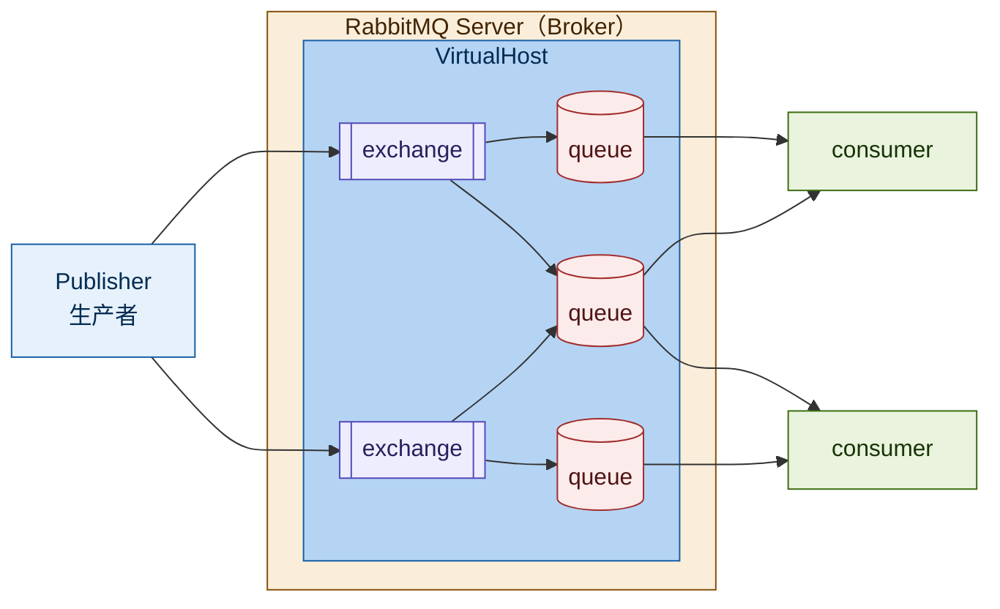

> **本日路线**：同步调用 vs 异步调用 → MQ 技术选型 → RabbitMQ 架构与核心概念 → AMQP / SpringAMQP → 快速收发消息 → 声明队列和交换机 → 消息转换器
>
> **一句话**：MQ 用「发消息 + 异步消费」换掉「同步等待」，解决耦合、性能和级联失败；RabbitMQ 里消息由**交换机按路由规则投递到队列**，生产者消费者都是连到 Broker 的客户端。

---

## 目录

- [[#一、同步调用与异步调用]]
- [[#二、MQ 技术选型]]
- [[#三、RabbitMQ 架构与核心概念]]
- [[#四、AMQP 与 SpringAMQP]]
- [[#五、快速入门]]
- [[#六、声明队列和交换机]]
- [[#七、消息转换器]]
- [[#八、面试考点]]
- [[#九、今日重点]]

---

## 一、同步调用与异步调用

### 1.1 同步调用

**问题**：

1. **拓展性差**：每加一个下游功能，都要改调用方代码
2. **性能下降**：调用方要等所有下游返回，响应时间 = 各环节之和
3. **级联失败**：任一环节挂了，整条链路失败

**优势**：时效性强，能等到结果再返回。

### 1.2 异步调用

异步调用就是基于**消息通知**的方式，包含三个角色：

1. **消息发送者**：投递消息的人，就是原来的调用方
2. **消息代理**：管理、暂存、转发消息，可以理解成微信服务器
3. **消息接收者**：接收和处理消息的人，就是原来的服务提供方

**优势**：

- 解除耦合，拓展性强（加功能只加消费者，不改生产者）
- 无需等待，性能好
- 故障隔离（下游挂了不影响主流程）
- 缓存消息，流量削峰填谷

**缺陷**：

- 不能立刻得到结果，时效性差
- 不确定下游业务是否执行成功
- 业务安全依赖 Broker（消息代理）的可靠性

> 一句话对比：**同步是打电话（必须等对方接），异步是发微信（发完就干别的）**。

---

## 二、MQ 技术选型

MQ（Message Queue），中文是消息队列，就是异步调用中的 **Broker**。

| 对比项 | RabbitMQ | ActiveMQ | RocketMQ | Kafka |
| --- | --- | --- | --- | --- |
| 公司/社区 | Rabbit | Apache | 阿里 | Apache |
| 开发语言 | Erlang | Java | Java | Scala&Java |
| 协议支持 | AMQP、XMPP、SMTP、STOMP | OpenWire、STOMP、REST、XMPP、AMQP | 自定义协议 | 自定义协议 |
| 可用性 | 高 | 一般 | 高 | 高 |
| 单机吞吐量 | 一般 | 差 | 高 | 非常高 |
| 消息延迟 | **微秒级** | 毫秒级 | 毫秒级 | 毫秒以内 |
| 消息可靠性 | 高 | 一般 | 高 | 一般 |

### 怎么记这张表

- **RabbitMQ**：延迟最低（微秒级）、可靠性高、生态成熟，但吞吐一般 → 适合**业务消息**（下单、通知、异步任务）
- **Kafka**：吞吐最高（十万级/秒），但可靠性一般、功能相对简单 → 适合**日志采集、埋点、大数据流**
- **RocketMQ**：吞吐高 + 可靠性高，阿里出品，支持事务消息 → 适合**电商交易、金融场景**
- **ActiveMQ**：老牌，性能差，基本淘汰，不用考虑

### 一句话选型口径（面试可答）

> 业务消息选 RabbitMQ（延迟低、可靠、轻量）；大数据/日志选 Kafka（吞吐）；交易类、需要事务消息选 RocketMQ。三者没有绝对优劣，看场景。

---

## 三、RabbitMQ 架构与核心概念

### 3.1 五个基本概念

1. **publisher**：消息发送者
2. **consumer**：消息的消费者
3. **queue**：队列，存储消息
4. **exchange**：交换机，负责路由消息
5. **virtual host**：虚拟主机，逻辑隔离单元，里面装着自己的一套 exchange 和 queue

### 3.2 整体架构



### 3.3 层级关系（这张图最关键的信息）

```
Publisher / Consumer        ← 客户端，在服务外部
        ↕
RabbitMQ Server（Broker）    ← 整个消息服务，一整套
    └── VirtualHost          ← 逻辑隔离单元，可以有多个
            ├── exchange × N ← 交换机，负责路由
            └── queue × N    ← 队列，真正存消息
```

**Broker 里可以开多个 VirtualHost，每个 VirtualHost 里各有自己的一套 exchange 和 queue。** 不同项目用不同 vhost，彼此看不到对方的队列。

### 3.4 补充概念（图上没标出来的）

| 概念 | 说明 |
| --- | --- |
| **Broker（Server）** | 整个 RabbitMQ 服务，图上那个大框。生产者、消费者都是**连到它**的客户端 |
| **VirtualHost（vhost）** | Broker 内的逻辑隔离单元，可以有多个，每个里面独立一套 exchange / queue；默认的是 `/` |
| **binding（绑定）** | 交换机和队列之间的连线，决定这个交换机能把消息投到哪些队列 |
| **routingKey（路由键）** | 生产者发消息时带的路由键，交换机会按规则（和 binding 匹配）决定投给哪个队列 |

### 3.5 消息流转的四步

```
① 生产者把消息发给交换机，带上 routingKey
② 交换机按绑定规则，把消息路由到一个或多个队列
③ 消息在队列里排队等待（队列才是真正存消息的地方）
④ 消费者监听队列，取走消息并处理
```

### 3.6 三个容易记错的点

1. **交换机不存消息**，它只负责路由；消息存在队列里。交换机没有匹配到队列时，消息直接丢失（除非配了备份交换机）
2. **一个队列可以被多个消费者监听**，消息会被**竞争消费**（一条消息只会被一个消费者拿到），这是做负载均衡的方式
3. **一个消费者也可以监听多个队列**，上图的 consumer 1 就连了两个队列

---

## 四、AMQP 与 SpringAMQP

**AMQP**：用于在应用程序之间传递业务消息的开放标准。该协议与语言和平台无关，更符合微服务中独立性的需求。

**Spring AMQP**：基于 AMQP 协议定义的一套 API 规范，提供模板来发送和接收消息。

- `spring-amqp`：基础抽象
- `spring-rabbit`：底层的默认实现

---

## 五、快速入门

### 5.1 引入依赖（publisher 和 consumer 都要加）

```xml
<!--AMQP依赖，包含RabbitMQ-->
<dependency>
    <groupId>org.springframework.boot</groupId>
    <artifactId>spring-boot-starter-amqp</artifactId>
</dependency>
```

### 5.2 配置服务端信息

```yaml
spring:
  rabbitmq:
    host: localhost        # 主机名（Docker 本机部署就填 localhost）
    port: 5672             # 端口
    virtual-host: /        # 虚拟主机
    username: guest        # 用户名
    password: guest        # 密码
```

### 5.3 发送消息

`RabbitTemplate` 是 SpringAMQP 提供的发送工具类：

```java
@Autowired
private RabbitTemplate rabbitTemplate;

@Test
public void testSimpleQueue() {
    String queueName = "simple.queue";          // 队列名称
    String message = "hello, spring amqp!";     // 消息
    rabbitTemplate.convertAndSend(queueName, message);   // 发送
}
```

### 5.4 接收消息

用 `@RabbitListener` 声明要监听的队列：

```java
@Component
public class SpringRabbitListener {

    @RabbitListener(queues = "simple.queue")
    public void listenSimpleQueue(String msg) {
        System.out.println("消费者接收到消息：【" + msg + "】");
    }
}
```

### 5.5 四步总结

1. 引入 `spring-boot-starter-amqp` 依赖
2. 配置 rabbitmq 服务端信息
3. 利用 `RabbitTemplate` 发送消息
4. 利用 `@RabbitListener` 注解声明要监听的队列，监听消息

---

## 六、声明队列和交换机

SpringAMQP 提供三个类来声明队列、交换机及绑定关系：

1. **Queue**：声明队列，可用工厂类 `QueueBuilder` 构建
2. **Exchange**：声明交换机，可用工厂类 `ExchangeBuilder` 构建
3. **Binding**：声明绑定关系，可用工厂类 `BindingBuilder` 构建

### 6.1 方式一：@Bean 声明

```java
@Configuration
public class FanoutConfiguration {

    @Bean
    public FanoutExchange fanoutExchange() {
        // ExchangeBuilder.fanoutExchange("").build();
        return new FanoutExchange("hmall.fanout2");
    }
}
```

**缺点**：要绑定多个对象时，得写多个 Binding Bean，太啰嗦：

```java
@Configuration
public class DirectConfiguration {

    @Bean
    public DirectExchange directExchange() {
        return new DirectExchange("itcast.direct");
    }

    @Bean
    public Queue directQueue1() {
        return new Queue("direct.queue1");
    }

    // routingKey = red
    @Bean
    public Binding bindingRed(DirectExchange directExchange, Queue directQueue1) {
        return BindingBuilder.bind(directQueue1).to(directExchange).with("red");
    }

    // 还要绑 blue，就得再加一个 Binding
    @Bean
    public Binding bindingBlue(DirectExchange directExchange, Queue directQueue1) {
        return BindingBuilder.bind(directQueue1).to(directExchange).with("blue");
    }
}
```

### 6.2 方式二：@RabbitListener 注解声明（推荐）

```java
@RabbitListener(bindings = @QueueBinding(
        value = @Queue(name = "direct.queue1", durable = "true"),   // durable 持久化
        exchange = @Exchange(name = "itcast.direct", type = ExchangeTypes.DIRECT),
        key = {"red", "blue"}                                       // 一个 key 数组搞定多个 routingKey
))
public void listenDirectQueue1(String msg) {
    System.out.println("消费者1接收到Direct消息：【" + msg + "】");
}
```

**优势**：队列、交换机、绑定、多个 routingKey 一行搞定，不用写一堆 Bean。

### 6.3 小结

| 问题 | 答案 |
| --- | --- |
| 声明队列、交换机、绑定的 Bean 是什么？ | `Queue`、`FanoutExchange` / `DirectExchange` / `TopicExchange`、`Binding` |
| 注解方式常用哪些注解？ | `@Queue`、`@Exchange`（外层是 `@QueueBinding`） |

---

## 七、消息转换器

### 7.1 问题：默认的 JDK 序列化

需求：向 `object.queue` 发送一条 Map 类型的消息。

```java
Map<String, Object> msg = new HashMap<>();
msg.put("name", "Jack");
msg.put("age", 21);
```

Spring 对消息对象的处理由 `org.springframework.amqp.support.converter.MessageConverter` 负责，默认实现是 `SimpleMessageConverter`，**基于 JDK 的 `ObjectOutputStream` 序列化**，存在三个问题：

1. JDK 序列化有**安全风险**
2. 序列化后的消息**太大**
3. 序列化结果**可读性差**（在管理台看到的是一堆乱码）

### 7.2 解决：换成 JSON 序列化

**第一步**：publisher 和 consumer 都引入 jackson 依赖

```xml
<dependency>
    <groupId>com.fasterxml.jackson.core</groupId>
    <artifactId>jackson-databind</artifactId>
</dependency>
```

**第二步**：两边都配置 `MessageConverter`

```java
@Bean
public MessageConverter messageConverter() {
    return new Jackson2JsonMessageConverter();
}
```

> **注意**：两边必须都配。只配一边会出现「发出去是 JSON、收到的解析不了」或反过来的问题。

---

## 八、面试考点

### Q1 为什么要用 MQ？同步调用有什么问题？

> 同步调用有三个问题：拓展性差（加下游要改调用方）、性能下降（响应时间叠加）、级联失败（一个环节挂全链路崩）。引入 MQ 变成异步调用后：解耦、削峰、故障隔离、提升响应速度。

### Q2 异步调用有什么缺点？

> 三方面：①不能立刻拿到结果，时效性差；②不确定下游是否执行成功（要靠确认机制兜底）；③业务安全依赖 Broker 的可靠性，Broker 挂了消息就丢了，所以要做持久化和高可用。

### Q3 RabbitMQ、Kafka、RocketMQ 怎么选？

> RabbitMQ 延迟最低（微秒级）、可靠性高，适合业务消息；Kafka 吞吐最高，适合日志、埋点、大数据；RocketMQ 兼顾吞吐和可靠、支持事务消息，适合电商交易。看场景，没有绝对优劣。

### Q4 交换机有哪几种类型？

> 常见四种：**fanout**（广播，不看 routingKey）、**direct**（按 routingKey 精确匹配）、**topic**（按通配符匹配，`*` 一个词、`#` 零或多个词）、**headers**（按消息头匹配，很少用）。

### Q5 交换机不存消息，那消息存在哪？没有队列匹配会怎样？

> 消息只存在队列里，交换机只做路由。如果交换机没有匹配到任何队列，消息会**直接丢弃**，所以生产上要么保证绑定关系正确，要么配置备份交换机（alternate exchange）。

### Q6 为什么建议用 JSON 序列化而不是默认的 JDK 序列化？

> JDK 序列化有三问题：有安全风险（反序列化漏洞）、消息体积大、可读性差。换成 `Jackson2JsonMessageConverter` 后消息是 JSON，可读、跨语言、体积小，**前提是生产者和消费者两侧都配置**。

### Q7 vhost 是什么？有什么用？

> VirtualHost 是 Broker 内的逻辑隔离单元，每个 vhost 里有独立的一套 exchange、queue 和权限。不同项目用不同 vhost 就能互不干扰，相当于「一个 RabbitMQ 里开了多个互不相通的独立空间」，默认的是 `/`。

### Q8 声明队列和交换机有哪两种方式？推荐哪个？

> ①`@Bean` 方式：分别声明 Queue、Exchange、Binding，绑定多个 routingKey 要写多个 Binding Bean，啰嗦；②`@RabbitListener` + `@QueueBinding` 注解方式：一个注解里把队列、交换机、多个 key 全声明完，推荐这种。

---

## 九、今日重点

### 9.1 必记 5 件事

1. **同步三大问题**：拓展性差、性能下降、级联失败；异步三大优势：解耦、削峰、故障隔离
2. **架构五概念**：publisher、consumer、exchange、queue、virtualHost，外面套一层 Broker
3. **消息只存在队列里**，交换机只负责路由，没匹配到队列就丢消息
4. **SpringAMQP 四步**：加依赖 → 配连接 → `RabbitTemplate` 发 → `@RabbitListener` 收
5. **序列化要换 JSON**：`Jackson2JsonMessageConverter`，**生产者和消费者都要配**

### 9.2 代码速记

```java
// 发送
rabbitTemplate.convertAndSend("simple.queue", message);

// 接收
@RabbitListener(queues = "simple.queue")
public void listen(String msg) { ... }

// 声明（注解方式，推荐）
@RabbitListener(bindings = @QueueBinding(
        value = @Queue(name = "direct.queue1", durable = "true"),
        exchange = @Exchange(name = "itcast.direct", type = ExchangeTypes.DIRECT),
        key = {"red", "blue"}
))

// JSON 序列化（两端都要）
@Bean
public MessageConverter messageConverter() {
    return new Jackson2JsonMessageConverter();
}
```

### 9.3 易错点清单

| ❌ 易错 | ✅ 正确 |
| --- | --- |
| 以为交换机也存消息 | 交换机只路由，消息存在队列 |
| 只给生产者配 JSON 转换器 | 生产者和消费者**都要**配 |
| 以为一个队列只能有一个消费者 | 可以多个，是**竞争消费**（一条消息只给一个） |
| 忘记配 `virtual-host` | 默认是 `/`，用自定义 vhost 必须显式配 |
| 用 `@Bean` 声明多个 routingKey 时漏写 Binding | 每个 key 都要一个 Binding，或用注解方式 |
| 队列名写错导致收不到消息 | 发送和监听的队列名必须完全一致 |

### 9.4 待补

| 知识点 | 状态 |
| --- | --- |
| 三种交换机（Fanout / Direct / Topic）实操 | 待学（MQ基础-10~12） |
| 消息转换器改造业务代码 | 待学（MQ基础-15~16） |
| 生产者可靠性：重连、确认机制 | 待学（MQ高级-02~04） |
| 消息持久化、LazyQueue | 待学（MQ高级-05~06） |
| 消费者确认、失败重试、业务幂等 | 待学（MQ高级-07~09） |
| 延迟消息（死信交换机、延迟插件） | 选学（MQ高级-10~15） |
