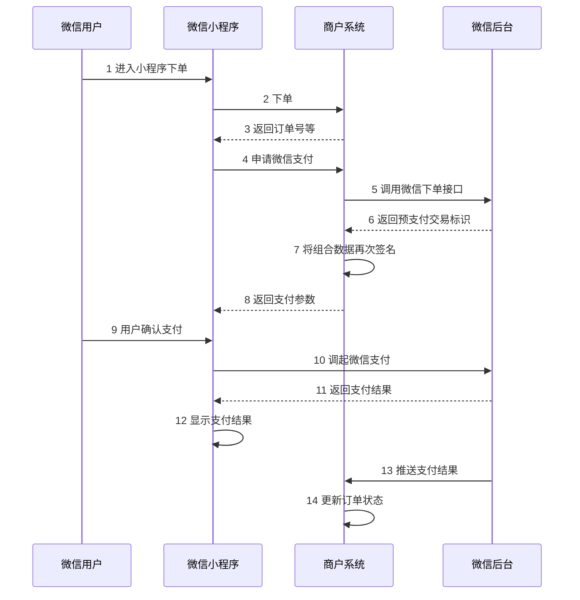

# Day07 笔记

> [!info] 项目
> 苍穹外卖 · 第 7 天
>
> 涉及内容：用户下单、微信支付（微信小程序支付时序图）、无商户号时的模拟支付、内网穿透（cpolar）
>
> 上一篇：[[苍穹外卖/day06]]

- **tags**: #苍穹外卖 #SpringBoot #微信支付 #订单 #cpolar

---

## 1. 用户下单功能

在 Impl 实现层要先处理各种业务异常（地址簿为空，购物车数据为空），接着向订单表插入一条数据，向订单明细表插入 n 条数据，然后再清空购物车数据。

---

## 2. 微信支付

### 2.1 微信小程序支付时序图

图中有 4 个参与角色：

| 角色 | 说明 |
|---|---|
| **微信用户** | 下单、确认支付的操作者 |
| **微信小程序** | 前端，展示订单、调起微信支付 |
| **商户系统** | 我们自己的后端服务（苍穹外卖） |
| **微信后台** | 微信支付平台 |



交互步骤（14 步）：

| 序号 | 方向 | 内容 |
|---|---|---|
| 1 | 微信用户 → 微信小程序 | 进入小程序下单 |
| 2 | 微信小程序 → 商户系统 | 下单 |
| 3 | 商户系统 → 微信小程序 | 返回订单号等 |
| 4 | 微信小程序 → 商户系统 | 申请微信支付 |
| 5 | 商户系统 → 微信后台 | 调用微信下单接口 |
| 6 | 微信后台 → 商户系统 | 返回预支付交易标识 |
| 7 | 商户系统（内部） | 将组合数据再次签名 |
| 8 | 商户系统 → 微信小程序 | 返回支付参数 |
| 9 | 微信用户 → 微信小程序 | 用户确认支付 |
| 10 | 微信小程序 → 微信后台 | 调起微信支付 |
| 11 | 微信后台 → 微信小程序 | 返回支付结果 |
| 12 | 微信小程序（内部） | 显示支付结果 |
| 13 | 微信后台 → 商户系统 | 推送支付结果 |
| 14 | 商户系统（内部） | 更新订单状态 |

### 2.2 关键要点

1. **下单与支付是两段流程**：先下单拿到订单号（步骤 1–3），再申请微信支付（步骤 4 起）。
2. **预支付交易标识（prepay_id）**：商户系统调用微信下单接口后，微信后台返回预支付交易标识（步骤 5–6）。
3. **再次签名（步骤 7）**：商户系统把 `prepay_id` 等组合数据用**商户私钥**再次签名，这一步必须在服务端完成，私钥绝不能下发到小程序。
4. **返回支付参数（步骤 8）**：后端把签名后的支付参数返回给小程序，小程序拿着参数调起微信支付。
5. **两条结果通道**：
   - 前端通道：微信后台把支付结果返回给小程序（步骤 11），小程序只用来**展示**（步骤 12）；
   - 后端通道：微信后台**异步推送**支付结果给商户系统（步骤 13），商户系统据此**更新订单状态**（步骤 14）。
   - 所以订单状态以**后端收到的推送为准**，不能只信前端显示，避免用户篡改或前端未回调导致订单状态不一致。
6. **商户系统需要提供支付结果回调接口**，用于接收步骤 13 的推送并完成步骤 14。

### 2.3 无商户号时的模拟支付

由于没有真实的商户号，本系统只能**跳过真实的支付功能**，把"真的付钱"这一段直接替换成"直接把订单改已支付"。

**【思路】**

真实流程：`payment()` 调微信支付下单 → 前端调起微信支付 → 支付成功后微信服务器回调 `PayNotifyController` → `paySuccess()` 把订单改已支付。

没有商户号，就把中间"真的付钱"这一段整个跳过：点支付 → 后端直接把订单状态改成"已支付" → 返回一个空的 VO 给前端。改动只需要一个文件、一处方法。

**【改动位置】**

文件：`sky-server/src/main/java/com/sky/service/impl/OrderServiceImpl.java`
位置：`payment` 方法（第 126~147 行）

原方法：

```java
/**
 * 订单支付
 */
public OrderPaymentVO payment(OrdersPaymentDTO ordersPaymentDTO) throws Exception {
    // 当前登录用户id
    Long userId = BaseContext.getCurrentId();
    User user = userMapper.getById(userId);

    // 调用微信支付接口，生成预支付交易单
    JSONObject jsonObject = weChatPayUtil.pay(
            ordersPaymentDTO.getOrderNumber(), // 商户订单号
            new BigDecimal(0.01),             // 支付金额，单位：元
            "苍穹外卖订单",                   // 商品描述
            user.getOpenid()                  // 微信用户的 openid
    );

    if (jsonObject.getString("code") != null && "ORDERPAID".equals(jsonObject.getString("code"))) {
        throw new OrderBusinessException("该订单已支付");
    }

    OrderPaymentVO vo = jsonObject.toJavaObject(OrderPaymentVO.class);
    vo.setPackageStr(jsonObject.getString("package"));
    return vo;
}
```

改为（模拟支付）：

```java
public OrderPaymentVO payment(OrdersPaymentDTO ordersPaymentDTO) throws Exception {
    // ===== 模拟支付：不调用真实微信支付接口，直接修改订单状态为已支付 =====
    String orderNumber = ordersPaymentDTO.getOrderNumber();

    // 根据订单号查询订单
    Orders ordersDB = orderMapper.getByNumber(orderNumber);
    if (ordersDB == null) {
        throw new OrderBusinessException("订单不存在");
    }
    // 校验当前订单是否属于当前登录用户，防止越权支付别人的订单
    Long userId = BaseContext.getCurrentId();
    if (ordersDB.getUserId().intValue() != userId.intValue()) {
        throw new OrderBusinessException("订单与用户不匹配");
    }
    // 订单已经是已支付，直接抛"该订单已支付"（防重复支付）
    if (ordersDB.getPayStatus() == Orders.PAID) {
        throw new OrderBusinessException("该订单已支付");
    }

    // 直接调用支付成功逻辑，把订单状态改为"待接单"、支付状态改为"已支付"
    paySuccess(orderNumber);

    // 返回一个空的 VO，前端拿不到真实的预支付信息，所以支付页不再弹出 wx.requestPayment，
    // 后端已经直接把订单改成已支付，前端刷新订单列表即可看到状态变化
    return new OrderPaymentVO();
    // ===== 模拟支付结束 =====
}
```

---

## 3. 内网穿透（cpolar）

没有真实商户号、本地又跑着服务时，用内网穿透把本地的 8080 暴露成一个公网临时域名，方便微信回调/小程序访问本地。

- **工具**：cpolar，控制台 `https://dashboard.cpolar.com`
- **token**：`NzIyNGVkODMtNDYyMS00YmZlLWJhNWItODM4Y2NjODBlY2U3`
- **安装目录**：`D:\software\cpolar`

操作步骤：

1. 打开 cmd，进入安装目录；
2. 首次授权（只需做一次）：

   ```bash
   cpolar.exe authtoken NzIyNGVkODMtNDYyMS00YmZlLWJhNWItODM4Y2NjODBlY2U3
   ```

   会输出 `Authtoken saved to configuration file: C:\Users\20469/.cpolar/cpolar.yml`；

3. 启动穿透：

   ```bash
   cpolar.exe http 8080
   ```

   即可获得临时域名，例如 `http://79eb6469.r9.cpolar.cn`，通过该域名即可访问本机 8080。

> [!warning] 注意
> 临时域名每次启动可能变化，配置微信回调地址/小程序合法域名时需要用当前有效的域名。

---

## 4. 今日重点

> [!star] 重点回顾
>
> 1. **用户下单**：处理业务异常（地址簿为空、购物车为空）→ 向订单表插 1 条 → 向订单明细表插 n 条 → 清空购物车。
> 2. **微信小程序支付时序**：用户下单 → 小程序调商户系统下单 → 商户系统调微信下单接口 → 返回预支付交易标识 → 商户系统再次签名 → 返回支付参数 → 用户确认支付 → 调起微信支付 → 展示支付结果 + 微信后台异步推送 → 商户系统更新订单状态。
> 3. **私钥只在服务端**：再次签名必须在商户系统完成。
> 4. **订单状态以后端异步推送为准**，前端返回的支付结果只用于展示。
> 5. **无商户号时**：跳过真实支付，`payment()` 直接 `paySuccess()` 改订单状态；用 cpolar 把本地 8080 穿透成临时域名。

---

## 5. 面试问题

> [!question] 🎤 面试题
> **问题**：结合苍穹外卖，说下微信小程序支付的完整流程？为什么订单状态要以"服务端收到的异步回调"为准，而不是前端返回的支付结果？

**参考答案**：

1. **完整流程**：用户下单 → 小程序调商户系统下单（拿到订单号）→ 小程序申请微信支付 → 商户系统调用微信下单接口 → 微信后台返回预支付交易标识 prepay_id → 商户系统用**商户私钥**对组合数据再次签名 → 返回支付参数给小程序 → 用户确认支付 → 小程序调起微信支付 → 微信后台返回支付结果给小程序（仅用于展示）。与此同时，微信后台把支付结果**异步推送**给商户系统 → 商户系统更新订单状态。
2. **为什么以服务端回调为准**：
   - 前端拿到的支付结果只用于展示，可能被篡改，或客户端网络中断没收到；
   - 服务端回调是微信确认"真正扣款成功"的权威通知，可信度高；
   - 以服务端为准才能保证订单状态与实际支付一致，防止"没付款却显示已付 / 付了款却显示未付"。
3. **回调接口要做**：签名校验（验真）、幂等（防重复支付/重复回调）、异常重试处理。
