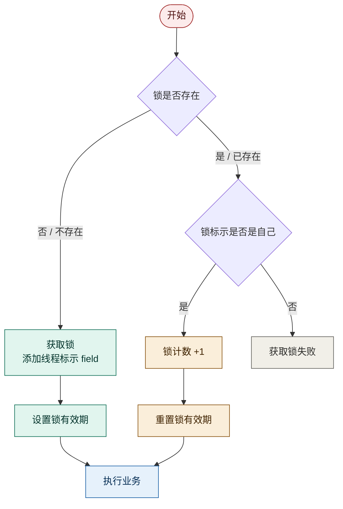
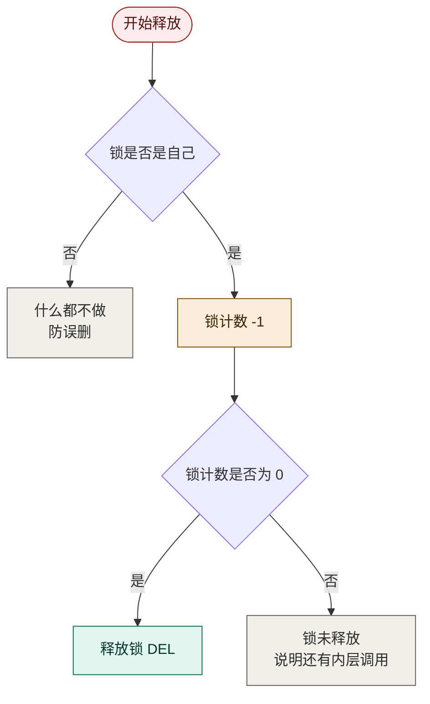

## 基于Redis的分布式锁优化

基于setnx实现的分布式锁存在下面的问题：
1，不可重入。同一个线程无法多次获取同一把锁
2，不可重试。获取锁只尝试一次就返回false，没有重试机制
3，超时释放。锁超时释放虽然可以避免死锁，但如果业务执行耗时较长，也会导致锁释放，存在安全隐患
4，主从一致性。如果Redis提供了主从集群，主从同步存在延迟，当主宕机时，如果从同步主中的锁数据，则会出现锁实现

## Redisson
Redisson是一个在Redis的基础上实现的Java驻内存数据网格（In-Memory Data Gird)。它不仅提供了一系列的分布式Java常用对象，还提供了许多分布式服务，其中就包含了各种分布式锁的实现

## Redisson 入门

### 1. 引入依赖

```xml
<dependency>
    <groupId>org.redisson</groupId>
    <artifactId>redisson</artifactId>
    <version>3.13.6</version>
</dependency>
```

### 2. 配置 Redisson 客户端

```java
@Configuration
public class RedisConfig {

    @Bean
    public RedissonClient redissonClient() {
        // 配置类
        Config config = new Config();
        // 添加 redis 地址，这里添加了单点的地址，也可以使用 config.useClusterServers() 添加集群地址
        config.useSingleServer().setAddress("redis://192.168.150.101:6379").setPassword("123321");
        // 创建客户端
        return Redisson.create(config);
    }
}
```

要点：

- `RedissonClient` 交给 Spring 容器管理，之后注入就能用
- 地址前缀必须带协议：`redis://`（不能只写 IP:端口）
- 单点用 `useSingleServer()`，集群用 `useClusterServers()`

### 3. 使用 Redisson 的分布式锁

```java
@Resource
private RedissonClient redissonClient;

@Test
void testRedisson() throws InterruptedException {
    // 获取锁（可重入），指定锁的名称
    RLock lock = redissonClient.getLock("anyLock");
    // 尝试获取锁，参数分别是：获取锁的最大等待时间（期间会重试），锁自动释放时间，时间单位
    boolean isLock = lock.tryLock(1, 10, TimeUnit.SECONDS);
    // 判断释放获取成功
    if (isLock) {
        try {
            System.out.println("执行业务");
        } finally {
            // 释放锁
            lock.unlock();
        }
    }
}
```

要点：

- `getLock("anyLock")`：拿到的 `RLock` 是可重入锁，同一个线程可以反复获取
- `tryLock(1, 10, SECONDS)` 三个参数：**等 1 秒**（期间重试抢锁）、**锁 10 秒后自动释放**、单位秒
- 获取成功才执行业务，`unlock()` 必须放 `finally`（和 JVM 锁一个习惯）
- 这四步正好对应手写锁的痛点：重试（1 秒内）、超时释放、防误删（内部已处理）

## Redisson可重入锁原理

### 1. 数据结构：String 换成 Hash

手写锁的 value 是一个字符串（线程标识），天然只能表达「有没有人持有」；可重入需要额外记录「同一线程拿了几次」，所以 Redisson 改用 **Hash**：

```
KEY:   lock（锁名）
FIELD: 线程标识（谁持有）
VALUE: 重入次数（拿了几次）
```

### 2. 加锁流程（对照流程图）



和手写锁的三点区别：

1. **SETNX 只看 key 存不存在**，重入必失败；Hash 先看 key，再看 field 是不是自己
2. 重入成功会**重置有效期**，业务再久锁也不丢
3. 不是自己才失败——别人依然被互斥在外

### 3. 释放流程（对照流程图）



**计数减到 0 才真删**——这就是可重入的核心：外面套了几层，就要解几层。

### 4. 重入演示（method1 → method2，同一线程）

| 步骤 | Redis 里的 Hash 结构 | 说明 |
| --- | --- | --- |
| method1 `tryLock()` | `lock: {thread1: 1}` | 首次获取，计数 1 |
| method2 `tryLock()` | `lock: {thread1: 2}` | 同线程重入，计数 **+1**，不失败 |
| method2 `unlock()` | `lock: {thread1: 1}` | 只减 1，**锁还在** |
| method1 `unlock()` | `lock` 被 **DEL** | 减到 0，真正释放 |

对照手写锁：method2 的 `tryLock()` 到这里会直接返回失败，`获取锁成功 2` 永远打不出来。

### 5. 一个隐藏点：这些步骤都是 Lua

「判断锁是否存在 → 判断是不是自己 → 计数 +1 → 重置有效期」是多步操作，中间不能被打断，所以 Redisson 的加锁、解锁**底层全部是 Lua 脚本**——和你手写锁用 Lua 解决误删是同一个思路，只是把更多步骤挪了进去。